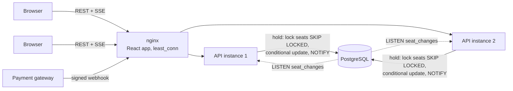

# Showtime: event ticketing with live seat maps

[](https://github.com/AnuragBhandary/Event-Ticketing-Platform/actions/workflows/ci.yml)
 

A BookMyShow-style ticketing app built around one promise: **a seat is never sold twice**, however
many people go for it at once. Buyers pick seats on a live seat map, hold them for 10 minutes and
pay through a gateway whose signed webhook confirms the booking. Every browser watching an event
sees seats being taken as it happens, whichever server it is connected to.

**Backend:** Java 25, Spring Boot 4 (Web MVC, Security with JWT, Data JPA, JdbcClient, Validation),
PostgreSQL 17 with Flyway, Server-Sent Events. **Frontend:** React 19, TypeScript, Vite, Tailwind CSS,
TanStack Query, React Router, React Hook Form + Zod. **Infra and tests:** Docker Compose (nginx in front
of two API instances), JUnit 5 + Testcontainers, Vitest + MSW, Playwright, k6, GitHub Actions.

### Measured results ([details](docs/BENCHMARKS.md))

| | |
|---|---|
| Booking rush: 200 buyers for 60 s at one 1,000-seat event, through nginx and two instances | **59,000+ hold attempts, 424 bookings (848 seats), 0 seats sold twice** (SQL audit) |
| Hold latency | all attempts p95 **1.6 ms**; holds that won median **14 ms**, p95 256 ms during the opening burst |
| 50 buyers racing for one seat (integration test) | **exactly 1** hold, 49 conflicts |
| Duplicate webhook delivered 5 times at once | **1** booking |
| Two buyers on different API instances (Playwright, 18/18 runs) | one wins the seat, the other sees it held and then booked live; an instance restart reconnects the stream |

## How it works



- **Seats are rows.** Each seat's status, hold and booking live on one row with check constraints,
  so a seat can only ever point at one booking.
- **Holding is all or nothing and never waits.** The hold transaction locks the requested seats with
  `FOR UPDATE SKIP LOCKED`; a seat another buyer is taking right now is skipped and reported as
  taken. Two buyers racing get an instant yes and an instant no, with no deadlocks.
- **Holds lapse by themselves.** A held seat past its expiry counts as free everywhere, so
  correctness never depends on a background job; a sweeper only tidies up and announces it.
- **Payment confirms via webhook.** Checkout creates one gateway order per hold. The gateway's
  webhook is HMAC-verified and deduplicated by event id inside the same transaction as the booking,
  so retries and concurrent duplicates book once. A payment that arrives after the hold lapsed still
  books if nobody took the seats, and is refunded if somebody did.
- **Live seat maps across instances.** Changes are announced with PostgreSQL `NOTIFY` from inside the
  transaction, so only committed changes are heard. Every instance `LISTEN`s and pushes them to its
  browsers over Server-Sent Events. Each seat has a version, so the browser merges the snapshot and
  live changes correctly in any order.

Reasoning and alternatives: **[docs/DESIGN.md](docs/DESIGN.md)**.

## Quick start

```bash
docker compose up -d --build --wait    # PostgreSQL, two API instances, nginx on :8090
open http://localhost:8090
```

Demo admin (local only): `admin@example.com` / `admin-password-change-me`. Register as a buyer from
the sign-in page. Payments go through **FakePay**, a stand-in gateway that signs and delivers
webhooks like Razorpay's; open the event in two browsers to watch seats change live.

### API

| | | |
|---|---|---|
| `POST` | `/api/auth/register`, `/api/auth/login` | Returns a JWT (8 h) |
| `GET` | `/api/events`, `/api/events/{id}` | Upcoming events with seats available / held / booked |
| `POST` | `/api/events` | Create an event with price tiers (ADMIN) |
| `GET` | `/api/events/{id}/seats` | Seat map: label, price, status, version |
| `GET` | `/api/events/{id}/seats/stream` | Live seat changes (Server-Sent Events) |
| `POST` | `/api/holds` | Hold seats for 10 minutes: 201, or 409 with the seats that were `taken` |
| `GET` / `DELETE` | `/api/holds/{id}` | Hold, its order and booking / release it |
| `POST` | `/api/holds/{id}/checkout` | Create the payment order (idempotent per hold) |
| `POST` | `/api/payments/webhook` | Gateway webhook: HMAC-SHA256 signed, deduplicated |
| `GET` | `/api/bookings` | Your bookings |

Errors are RFC 9457 `application/problem+json` with a stable `code` (`seats_unavailable`,
`hold_expired`, `bad_signature`, ...).

## Testing

```bash
make api-test   # 24 integration tests on real PostgreSQL (Testcontainers), 95% line coverage
make web-test   # ESLint, tsc, 25 Vitest tests (MSW for REST, a fake EventSource), 96% lines
make e2e        # Playwright against the compose stack
make rush       # k6 booking rush + the double-booking audit
```

- **Concurrency:** 50 buyers race for one seat; 80 buyers grab random overlapping 3-seat sets and no
  seat ends up in two holds, checked against the database seat by seat.
- **Payments:** idempotent checkout, five concurrent copies of one webhook, failure then retry,
  late payment honoured or refunded, bad signatures, amount mismatch.
- **Live:** subscribers see holds and bookings as they commit, a rolled-back hold announces nothing,
  and shutdown closes streams so graceful shutdown never waits on them.
- **Browser:** two buyers whose streams are on different instances race for a seat, pay, and survive
  an instance restart (`web/e2e/booking.spec.ts`).

## Layout

```
api/src/main/java/.../ticketing/
  events/     Event (JPA), SeatRepository (all seat-state SQL), EventService, controller
  holds/      HoldService (SKIP LOCKED holds, expiry sweep), HoldRepository, controller
  payments/   checkout, webhook (HMAC, dedupe), FakeGatewayController (FakePay)
  bookings/   BookingService (payment -> booking, exactly once)
  live/       SeatChangePublisher (NOTIFY), SeatChangeListener (LISTEN), SeatStreamHub (SSE)
  auth/       users, JWT issuing, register/login
  config/     security (JWT resource server), properties, clock
api/src/main/resources/db/migration/   Flyway schema
web/src/      pages, components (SeatMap), live/ (useLiveSeats, version merge), api/
web/e2e/      Playwright
load/         k6 booking rush, audit.sql, results/
deploy/       nginx.conf
docs/         DESIGN.md, BENCHMARKS.md, INTERVIEW.md
```
